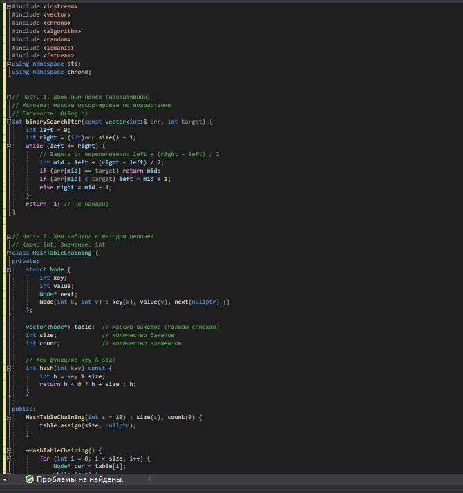
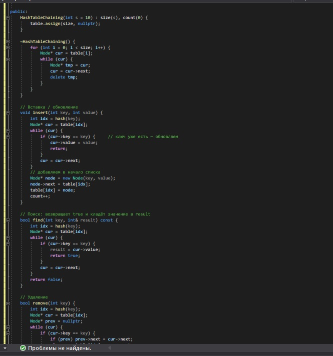
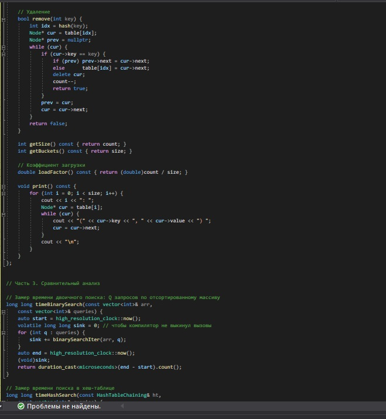
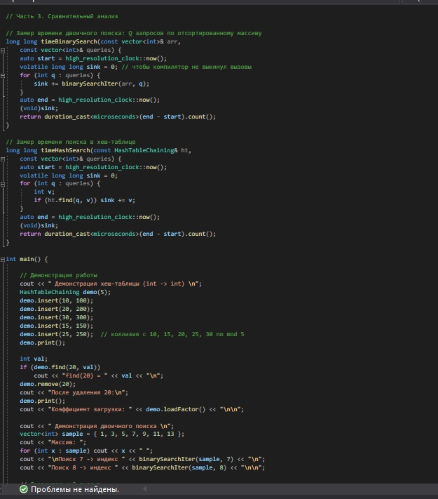
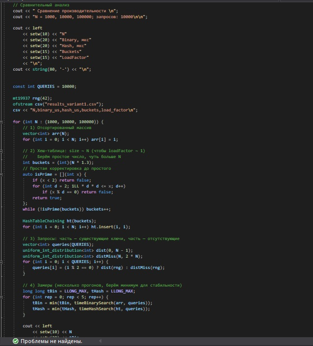
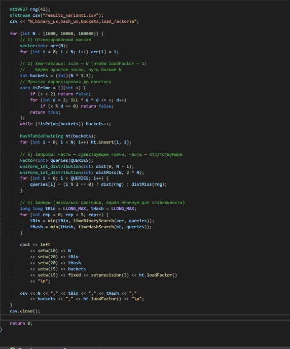
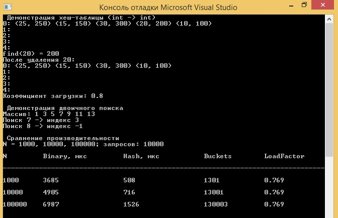

# Лабораторная работа №8
## Двоичный поиск. Хеш-таблицы

**Выполнила:** *Агафонова Софья Сергеевна*  
**Группа:** *ПИЖ-б-о-25-1*  
**Вариант:** 1 
---

## Цель работы

1. Реализовать алгоритм двоичного (бинарного) поиска в 
отсортированном массиве 
2. Освоить итеративную и рекурсивную реализации двоичного 
поиска 
3. Изучить понятие хеш-таблицы, хеш-функции и методы 
разрешения коллизий 
4. Реализовать хеш-таблицу с методом цепочек и открытой 
адресацией 
5. Сравнить производительность двоичного поиска и хеш-таблицы 
---
# Теоретическая часть

# Теоретическая часть

## 1. Двоичный поиск

**Двоичный поиск** — алгоритм поиска элемента в **отсортированном** массиве, который на каждом шаге делит интервал поиска пополам.

**Принцип работы:**

1. Находим средний элемент интервала поиска.
2. Сравниваем с искомым значением.
3. Если равно — возвращаем индекс.
4. Если искомое больше — ищем в правой половине.
5. Если меньше — ищем в левой половине.

**Сложность:**

| Характеристика | Значение |
|---|---|
| Лучший случай | O(1) |
| Средний случай | O(log n) |
| Худший случай | O(log n) |
| Память (итеративно) | O(1) |
| Память (рекурсивно) | O(log n) |

**Итеративная реализация:**

```cpp
int binarySearchIter(const int arr[], int n, int target) {
    int left = 0, right = n - 1;
    while (left <= right) {
        int mid = left + (right - left) / 2;
        if (arr[mid] == target) return mid;
        if (arr[mid] < target) left = mid + 1;
        else right = mid - 1;
    }
    return -1;
}
```

**Рекурсивная реализация:**

```cpp
int binarySearchRecur(const int arr[], int left, int right, int target) {
    if (left > right) return -1;
    int mid = left + (right - left) / 2;
    if (arr[mid] == target) return mid;
    if (arr[mid] < target)
        return binarySearchRecur(arr, mid + 1, right, target);
    return binarySearchRecur(arr, left, mid - 1, target);
}
```

---

## 2. Хеш-таблицы

**Хеш-таблица** — структура данных для хранения пар «ключ → значение» с доступом в среднем за O(1).

**Сложность операций:**

| Операция | Средний случай | Худший случай |
|---|---|---|
| Вставка | O(1) | O(n) |
| Поиск | O(1) | O(n) |
| Удаление | O(1) | O(n) |

**Требования к хеш-функции:**

1. Детерминированность (один ключ → один хеш).
2. Равномерное распределение.
3. Быстрое вычисление.

**Примеры хеш-функций:**

```cpp
// Для целых чисел
int hash1(int key, int size) {
    return key % size;
}

// Для строк
int hashCode(const string& key, int size) {
    int hash = 0;
    for (char c : key) hash = (hash * 31 + c) % size;
    return hash;
}
```

---

## 3. Методы разрешения коллизий

**Коллизия** — ситуация, когда два разных ключа дают одинаковый хеш.

### 3.1. Метод цепочек (Chaining)

При коллизии элементы с одинаковым хешем хранятся в связном списке.

```cpp
template <typename K, typename V>
struct Node {
    K key;
    V value;
    Node* next;
    Node(const K& k, const V& v) : key(k), value(v), next(nullptr) {}
};

template <typename K, typename V>
class HashTableChaining {
private:
    vector<Node<K, V>*> table;
    int size;
    int hash(const K& key) const { return key % size; }
public:
    HashTableChaining(int s) : size(s), table(s, nullptr) {}

    void insert(const K& key, const V& value) {
        int index = hash(key);
        Node<K, V>* newNode = new Node<K, V>(key, value);
        newNode->next = table[index];
        table[index] = newNode;
    }

    V* find(const K& key) const {
        int index = hash(key);
        Node<K, V>* current = table[index];
        while (current != nullptr) {
            if (current->key == key) return &current->value;
            current = current->next;
        }
        return nullptr;
    }
};
```

### 3.2. Открытая адресация (Open Addressing)

При коллизии ищется следующий свободный бакет.

| Метод | Формула | Описание |
|---|---|---|
| Линейное пробирование | `(hash + i) % size` | Поиск следующей свободной ячейки |
| Квадратичное пробирование | `(hash + i²) % size` | Поиск с квадратичным шагом |
| Двойное хеширование | `(hash1 + i * hash2) % size` | Вторая хеш-функция |

```cpp
template <typename K, typename V>
class HashTableOpenAddressing {
private:
    struct Entry {
        K key;
        V value;
        bool occupied;
        Entry() : occupied(false) {}
    };
    vector<Entry> table;
    int size;
    int hash(const K& key) const { return key % size; }
public:
    HashTableOpenAddressing(int s) : size(s), table(s) {}

    void insert(const K& key, const V& value) {
        int index = hash(key);
        int i = 0;
        while (table[(index + i) % size].occupied) {
            if (table[(index + i) % size].key == key) break;
            i++;
        }
        int pos = (index + i) % size;
        table[pos].key = key;
        table[pos].value = value;
        table[pos].occupied = true;
    }

    V* find(const K& key) {
        int index = hash(key);
        int i = 0;
        while (table[(index + i) % size].occupied) {
            int pos = (index + i) % size;
            if (table[pos].key == key) return &table[pos].value;
            i++;
        }
        return nullptr;
    }
};
```

### 3.3. Сравнение методов

| Характеристика | Метод цепочек | Линейное пробирование | Квадратичное пробирование |
|---|---|---|---|
| Использование памяти | Дополнительная на указатели | Только массив | Только массив |
| Кластеризация | Нет | Да (первичная) | Меньше (вторичная) |
| Производительность | Хорошая | Средняя | Хорошая |
| Простота реализации | Средняя | Простая | Средняя |
---
## Постановка задачи

**Общее задание:** реализовать алгоритм двоичного (бинарного) поиска в отсортированном массиве, освоить итеративную и рекурсивную реализации, изучить понятие хеш-таблицы, хеш-функции и методы разрешения коллизий, реализовать хеш-таблицу с методом цепочек и открытой адресацией, сравнить производительность двоичного поиска и хеш-таблицы.

## 1. Двоичный поиск

**Задание по варианту 1:**

| № вар. | Тип данных | Особенности |
|:---:|:---:|:---|
| **1** | `int` | Итеративная реализация |

**Требования к реализации:**

- Написать функцию итеративного двоичного поиска для массива целых чисел (`int`), отсортированного по возрастанию.
- Функция должна принимать массив (или `std::vector<int>`), его размер и искомое значение, возвращать индекс найденного элемента или `-1`, если элемент отсутствует.
- Предусмотреть корректное вычисление середины интервала: `mid = left + (right - left) / 2` (защита от переполнения).
- Для сравнения реализовать также линейный поиск (вспомогательно).

## 2. Хеш-таблица

**Задание по варианту 1:**

| № вар. | Метод разрешения коллизий | Тип ключа | Тип значения |
|:---:|:---|:---:|:---:|
| **1** | Метод цепочек | `int` | `int` |

**Требования к реализации:**

- Реализовать класс хеш-таблицы с **методом цепочек** (chaining) для хранения пар «ключ → значение» типа `int → int`.
- Класс должен поддерживать операции:
  - `insert(key, value)` — вставка или обновление значения по ключу;
  - `find(key, result)` — поиск значения по ключу (возвращает `true`/`false`);
  - `remove(key)` — удаление пары по ключу;
  - `print()` — вывод содержимого таблицы по бакетам;
  - `loadFactor()` — коэффициент загрузки.
- Реализовать хеш-функцию `key % size` с корректной обработкой отрицательных ключей.
- Предусмотреть деструктор для освобождения памяти узлов связных списков.

## 3. Сравнительный анализ

**Задание для всех вариантов:**

1. Реализовать класс хеш-таблицы согласно варианту.
2. Реализовать двоичный поиск (итеративно).
3. Сравнить производительность операций поиска для **N = 1000, 10 000, 100 000** элементов:
   - двоичный поиск в отсортированном массиве;
   - поиск в хеш-таблице.
4. Построить таблицу/график зависимости времени от N.

**Требования к замеру:**

- Использовать `std::chrono::high_resolution_clock`.
- Для каждого N выполнить серию запросов (например, 10 000), включающих как существующие, так и отсутствующие ключи.
- Замерять время каждой операции поиска и суммировать.
- Для стабильности выполнить несколько прогонов и взять минимальное время.
---

## Индивидуальное задание



*Рисунок 1- Код программы*



*Рисунок 2- Код программы*



*Рисунок 3- Код программы*



*Рисунок 4- Код программы*



*Рисунок 5- Код программы*



*Рисунок 6- Код программы*

## Результаты работы программы


*Рисунок 7- Результат программы*

---
## Ответы на контрольные вопросы

**1. Какое условие необходимо для применения двоичного поиска?**

Массив должен быть **отсортирован** (по возрастанию или по убыванию), а для элементов должен быть определён оператор сравнения (`<`, `==`). Кроме того, должен быть обеспечен **произвольный доступ** к элементам по индексу (массив или `std::vector`), поскольку алгоритм обращается к среднему элементу. Для связного списка двоичный поиск неприменим.

---

**2. Какова сложность двоичного поиска? Почему она логарифмическая?**

- Лучший случай — **O(1)**: искомый элемент сразу оказался в середине.
- Средний и худший случаи — **O(log n)**.
- Память: **O(1)** итеративно, **O(log n)** рекурсивно (стек вызовов).

Сложность логарифмическая, потому что на каждом шаге интервал поиска **уменьшается вдвое**: из n элементов остаётся n/2, затем n/4, n/8 и т.д. Число шагов k удовлетворяет уравнению n / 2ᵏ = 1, откуда k = log₂n.

---

**3. В чём разница между итеративной и рекурсивной реализацией двоичного поиска?**

| Характеристика | Итеративная | Рекурсивная |
|---|---|---|
| Память | O(1) | O(log n) — стек вызовов |
| Скорость | Обычно быстрее (нет накладных расходов на вызовы) | Медленнее из-за вызовов функций |
| Читаемость | Цикл `while` | Ближе к математическому определению |
| Риск переполнения стека | Нет | Есть при очень большой глубине (на практике log₂n мал) |

Алгоритмически обе реализации эквивалентны и дают одинаковый результат.

---

**4. Чем опасен вариант `mid = (left + right) / 2`? Как правильно вычислять середину?**

При больших значениях `left` и `right` (близких к `INT_MAX`) сумма `left + right` может **переполнить** тип `int` и стать отрицательной. Это приводит к неверному индексу, выходу за границы массива или бесконечному циклу.

Правильный вариант:

```cpp
int mid = left + (right - left) / 2;
```

Здесь `right - left` не превосходит `INT_MAX`, поэтому переполнения не возникает.

---

**5. Что такое хеш-таблица? Из каких компонентов она состоит?**

**Хеш-таблица** — структура данных, хранящая пары «ключ → значение» и обеспечивающая в среднем **O(1)** на вставку, поиск и удаление.

Компоненты:

1. **Массив бакетов (слотов)** — основное хранилище.
2. **Хеш-функция** `h(key)` — отображает ключ в индекс массива.
3. **Механизм разрешения коллизий** — цепочки или открытая адресация.
4. **Коэффициент загрузки** и (опционально) **механизм рехеширования**.

---

**6. Какие требования предъявляются к хеш-функции?**

1. **Детерминированность** — один и тот же ключ всегда даёт один и тот же хеш.
2. **Равномерное распределение** — ключи распределяются по бакетам примерно одинаково, чтобы минимизировать коллизии.
3. **Быстрое вычисление** — O(1) для чисел, O(длины ключа) для строк.
4. (Желательно) **Устойчивость к закономерностям ключей** — например, ключи вида `k·size` не должны попадать все в один бакет.

---

**7. Что такое коллизия в хеш-таблице? Как с ней бороться?**

**Коллизия** — ситуация, когда два разных ключа дают одинаковый хеш и попадают в один бакет.

Методы борьбы:

- **Метод цепочек (chaining)** — элементы с одинаковым хешем хранятся в связном списке.
- **Открытая адресация** — при занятости бакета ищется следующий свободный по правилу:
  - линейное пробирование `(h + i) % size`;
  - квадратичное пробирование `(h + i²) % size`;
  - двойное хеширование `(h₁ + i·h₂) % size`.

---

**8. В чём отличие метода цепочек от открытой адресации?**

| Характеристика | Метод цепочек | Открытая адресация |
|---|---|---|
| Где хранятся коллизии | В связных списках вне массива | В самом массиве |
| Доп. память | Указатели на узлы | Нет |
| Локальность (кеш) | Плохая | Хорошая |
| Удаление | Простое | Сложное (нужны tombstones) |
| Коэффициент загрузки | Может быть > 1 | Должен быть < 1 (обычно ≤ 0.75) |
| Кластеризация | Отсутствует | Присутствует |
| Поведение при заполнении | Плавная деградация | Резкая деградация около α → 1 |

---

**9. Что такое первичная и вторичная кластеризация?**

- **Первичная кластеризация** — возникает при **линейном пробировании**: занятые ячейки сливаются в длинные непрерывные блоки, из-за чего растёт среднее число проб и время поиска.
- **Вторичная кластеризация** — возникает при **квадратичном пробировании**: кластеры также образуются, но менее выраженно и не сливаются в сплошные блоки.

Двойное хеширование практически устраняет кластеризацию.

---

**10. Какова средняя и худшая сложность операций в хеш-таблице?**

| Операция | Средний случай | Худший случай |
|---|---|---|
| Вставка | O(1) | O(n) |
| Поиск | O(1) | O(n) |
| Удаление | O(1) | O(n) |

Худший случай O(n) достигается, когда все ключи попали в один бакет (плохая хеш-функция или специально подобранные ключи).

---

**11. Когда эффективнее использовать двоичный поиск, а когда — хеш-таблицу?**

**Двоичный поиск эффективнее, когда:**

- массив уже отсортирован и данные редко меняются;
- важна компактность памяти (только массив, без доп. структур);
- нужны операции «диапазон», «ближайший элемент» (например, через `std::lower_bound`);
- нет требований к O(1).

**Хеш-таблица эффективнее, когда:**

- частые вставки, поиски и удаления по ключу;
- порядок элементов не важен;
- ключи распределяются равномерно;
- важна средняя сложность O(1).

---

**12. Что такое коэффициент загрузки хеш-таблицы? Почему он важен?**

Коэффициент загрузки:

$$
\alpha = \frac{\text{count}}{\text{buckets}}
$$

где `count` — число элементов, `buckets` — число бакетов.

Почему важен:

- При росте α растёт **средняя длина цепочек** (chaining) и **среднее число проб** (open addressing).
- При α → 1 в открытой адресации операции деградируют до O(n).
- Практический порог: **α ≤ 0.75**.

---

**13. Как работает рехеширование (динамическое расширение хеш-таблицы)?**

Когда коэффициент загрузки превышает порог (например, 0.75):

1. Создаётся новый массив бакетов, обычно **в 2 раза больше** (часто округляют до простого числа).
2. Для каждого элемента старой таблицы вычисляется **новый хеш** от нового размера.
3. Элементы переставляются в новую таблицу.
4. Старая таблица освобождается.

Амортизированная стоимость вставки остаётся **O(1)**, хотя отдельная операция рехеширования стоит **O(n)**.

---

**14. Как выбрать размер хеш-таблицы? Почему часто выбирают простое число?**

Размер выбирают так, чтобы коэффициент загрузки был ≤ 0.75, а число бакетов было **простым числом**.

Почему простое:

- При `key % size` ключи, имеющие общий делитель с размером (например, все чётные при чётном `size`), попадут только в часть бакетов — это вызывает **закономерные коллизии**.
- Простое число гарантирует, что `key % size` распределяет ключи равномернее (особенно если ключи имеют регулярную структуру: шаг, кратность и т.п.).

---

**15. Как реализовать хеш-функцию для строк?**

Используют **полиномиальный хеш**:

$$
h = (h \cdot p + c) \bmod size
$$

где `p` — небольшое простое число (часто 31, 33, 37), `c` — код символа.

Пример на C++:

```cpp
int hashCode(const std::string& key, int size) {
    unsigned long long h = 0;
    for (unsigned char c : key)
        h = (h * 31 + c) % size;
    return (int)h;
}
```

Множитель 31 (простое) и тип `unsigned long long` помогают избежать переполнения и улучшить распределение. Иногда используют беззнаковую арифметику по модулю 2⁶⁴, а `% size` берут на выходе.

---

## Выводы

В ходе выполнения лабораторной работы я:
1. Реализовать алгоритм двоичного (бинарного) поиска в 
отсортированном массиве 
2. Освоить итеративную и рекурсивную реализации двоичного 
поиска 
3. Изучить понятие хеш-таблицы, хеш-функции и методы 
разрешения коллизий 
4. Реализовать хеш-таблицу с методом цепочек и открытой 
адресацией 
5. Сравнить производительность двоичного поиска и хеш-таблицы 
---

**Ссылка на Git-репозиторий с кодом программы:**  
https://github.com/agafonovasofa631-collab/8.git
